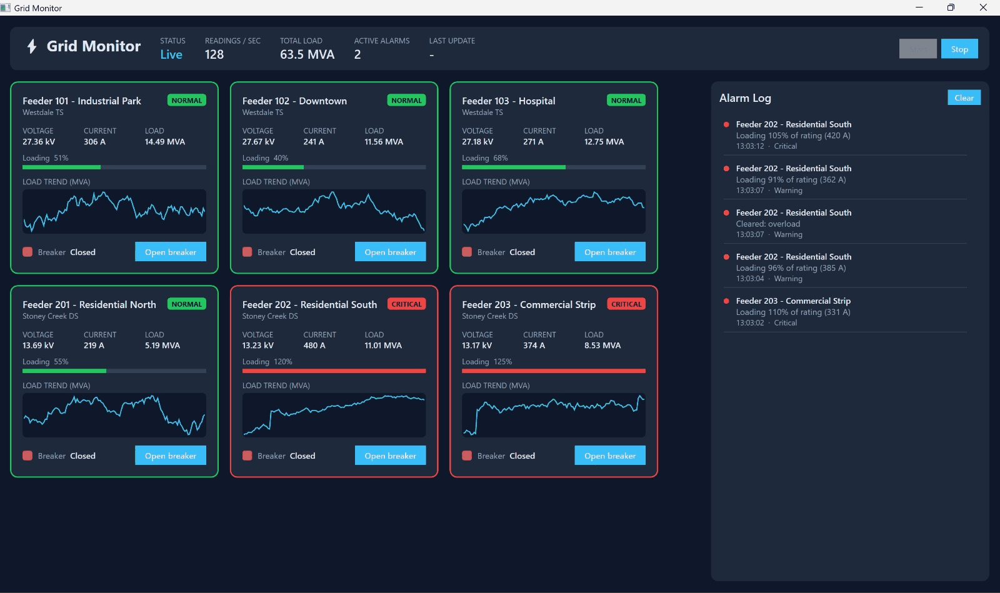
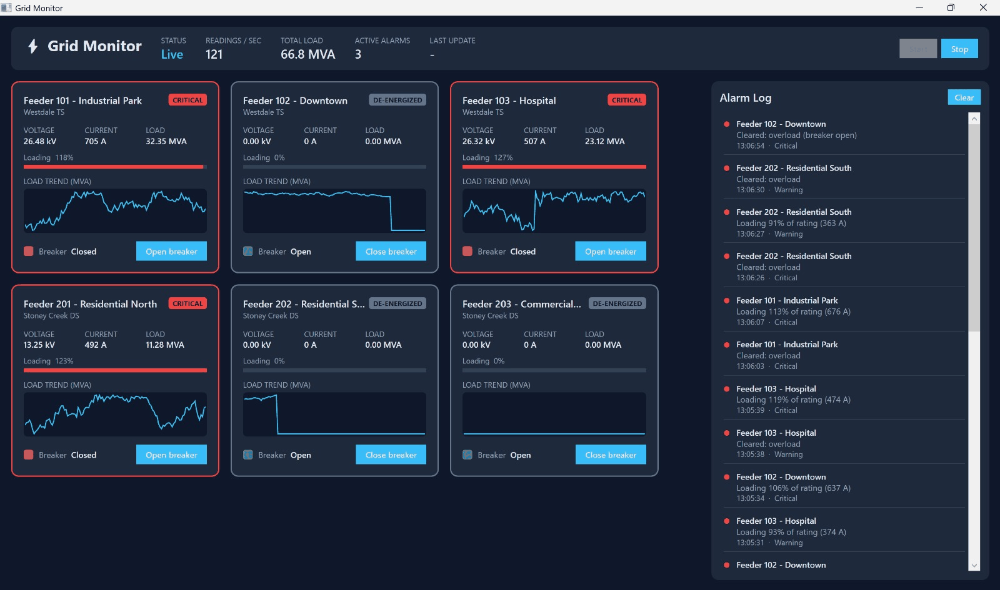
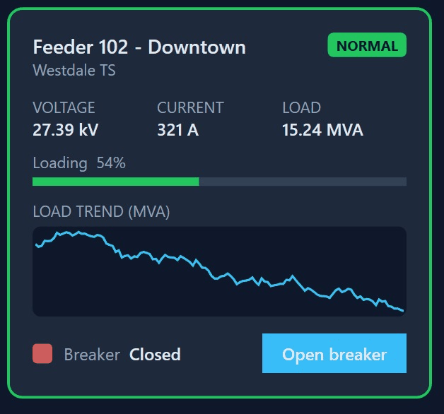
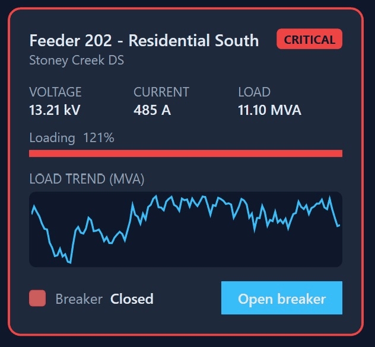

# ⚡ Grid Monitor — Real-Time Power Grid Dashboard (C# / WPF)

A Windows desktop app that monitors a simulated electrical distribution network in real time, in the spirit of the operator screens used in utility control rooms (SCADA / ADMS). Six feeders across two substations stream voltage, current and breaker status about **120 times per second**, and the UI stays smooth while showing live values, trend lines and alarms, and letting the operator open or close breakers.

Built to practise the things that matter in real-time desktop software: **MVVM**, **keeping the UI thread free**, **producer/consumer pipelines**, and **testable design**.



## ✨ Features
- **Live feeder cards**: voltage (kV), current (A), load (MVA), loading % of rating, and a 120-point load trend line
- **Breaker control**: open/close commands sent asynchronously to the (simulated) field device, with a pending state while the command is in flight
- **Alarm engine**: overload warnings (≥90% of rating), critical alarms (≥105%) and under-voltage alarms (<0.95 pu), with a **deadband** so alarms don't flicker when a value hovers at the limit
- **Alarm log**: newest first, capped at 200 entries, colour-coded by severity
- **Header stats**: live/stopped, readings per second, total system load, active alarm count

## 📸 Screenshots

**Operator opens breakers**: de-energized feeders drop to zero and their alarms clear in the log


| Normal feeder | Feeder in critical overload |
|---|---|
|  |  |

## 🧱 Architecture

```
            background threads                                 UI thread
┌──────────────────────────┐   Channel<T>   ┌───────────────────────┐  every 200 ms  ┌──────────────┐
│ SimulatedDataSource      │ ─────────────▶ │ TelemetryProcessor    │ ─────────────▶ │ MainViewModel │ ─▶ WPF bindings
│ (IDataSource)            │  bounded,       │ keeps LATEST reading  │ Dispatcher     │ FeederVMs     │
│ PeriodicTimer, 50 ms     │  drop-oldest    │ per feeder (coalesce) │ .InvokeAsync   │ AlarmEngine   │
└──────────────────────────┘                └───────────────────────┘                └──────────────┘
```

**How the UI stays responsive**
1. Data is produced and consumed on **background tasks** (`Task.Run`, `PeriodicTimer`, `IAsyncEnumerable`)
2. A **bounded `Channel<T>`** decouples producer and consumer; if the consumer falls behind, the oldest readings are dropped instead of memory growing
3. Readings are **coalesced**: only the latest value per feeder is kept between UI refreshes
4. The UI is updated **5 times per second** in one batch via `Dispatcher.InvokeAsync` at `Background` priority, so user input always wins
5. Trend points are **frozen** `PointCollection`s and the alarm list is **virtualized**

**Design choices**
- **MVVM**: `MainWindow.xaml` has no code-behind logic; everything is data-bound to view models (`INotifyPropertyChanged`, `ICommand`)
- **Interface-based data source**: the app depends on `IDataSource`, so the simulator can be replaced by a real protocol adapter (e.g. DNP3 / Modbus) or a test fake without changing any view model
- **UI-agnostic core**: view models, alarm logic and the pipeline live in `GridMonitor.Core` (plain .NET 8, no WPF), which is why they can be unit-tested on any OS. The UI thread is abstracted behind `IUiDispatcher`
- **No MVVM framework**: `ObservableObject`, `RelayCommand` and `AsyncRelayCommand` are implemented from scratch in `Core/Mvvm`

## 📁 Project structure
```
src/
  GridMonitor.Core/            .NET 8 class library (no UI dependencies)
    Mvvm/                      ObservableObject, RelayCommand, AsyncRelayCommand
    Models/                    TelemetryReading, FeederConfig, Alarm, BreakerCommand
    Data/                      IDataSource + SimulatedDataSource (Channel<T> producer)
    Processing/                TelemetryProcessor (coalescing + throttled UI flush)
    Alarms/                    AlarmEngine (limits + deadband)
    Collections/               RingBuffer<T> for trend history
    ViewModels/                MainViewModel, FeederViewModel
  GridMonitor.App/             WPF app (net8.0-windows): XAML views, converters, WpfDispatcher
tests/
  GridMonitor.Core.Tests/      xUnit tests for the alarm engine, pipeline, view models and commands
```

## ▶️ Run it
Requires Windows and the [.NET 8 SDK](https://dotnet.microsoft.com/download/dotnet/8.0).

```bash
dotnet run --project src/GridMonitor.App
```

Or download the ready-to-run `GridMonitor.exe` from the latest successful [Actions](../../actions) run (artifact **GridMonitor-win-x64**).

Run the tests (works on Windows, macOS and Linux):
```bash
dotnet test tests/GridMonitor.Core.Tests
```

## 🛠️ Tech
C# 12 · .NET 8 · WPF · MVVM · async/await · `System.Threading.Channels` · `IAsyncEnumerable` · xUnit · GitHub Actions (build, test, publish single-file exe)

## 🗺️ Ideas for next steps
- Replace the simulator with a Modbus TCP client
- Persist alarms to SQLite and add acknowledgement
- One-line diagram view of the network
